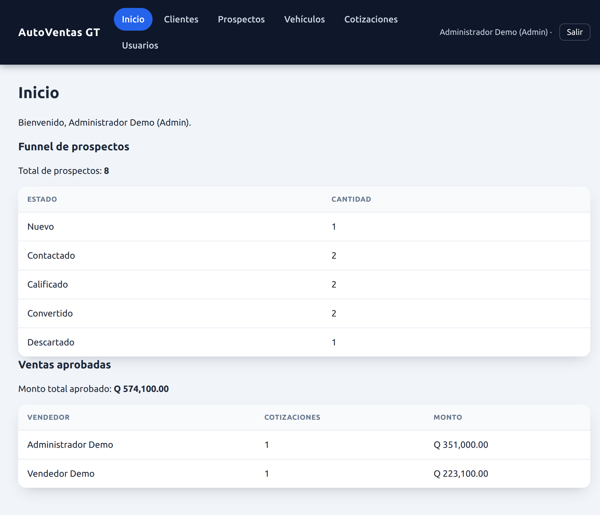
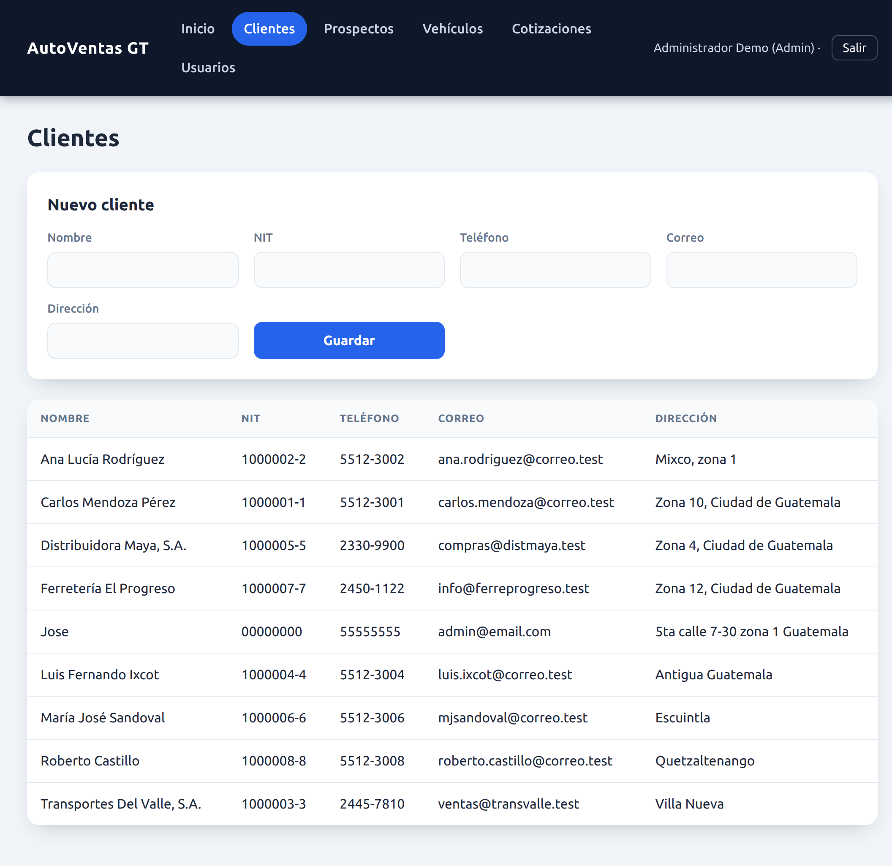
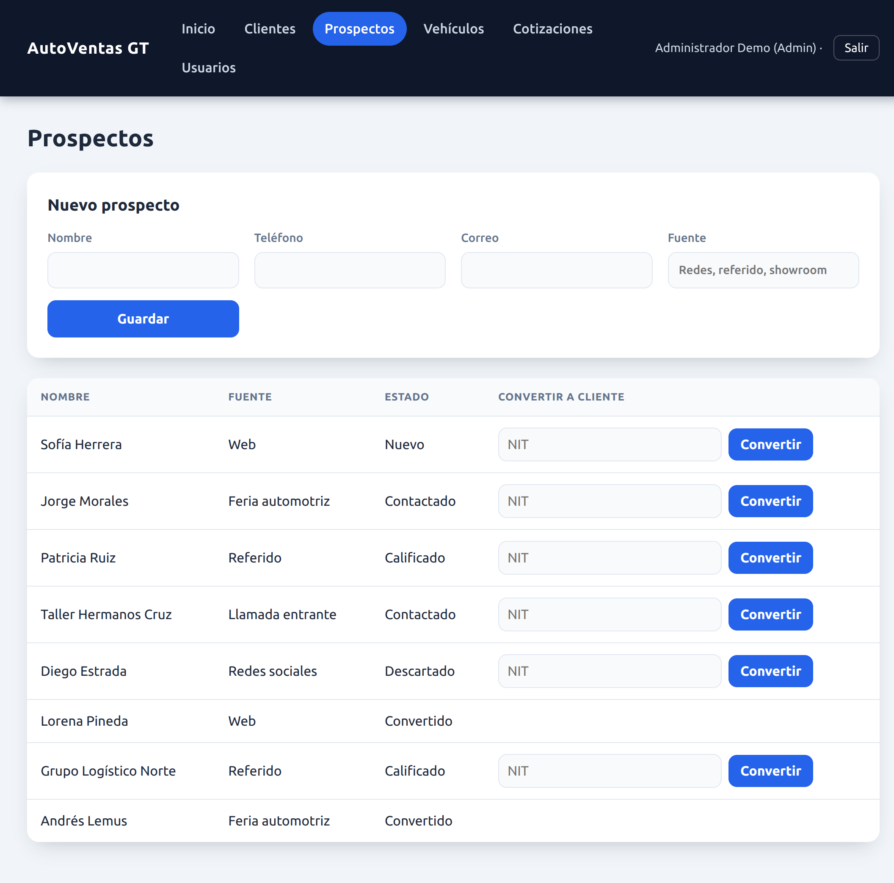
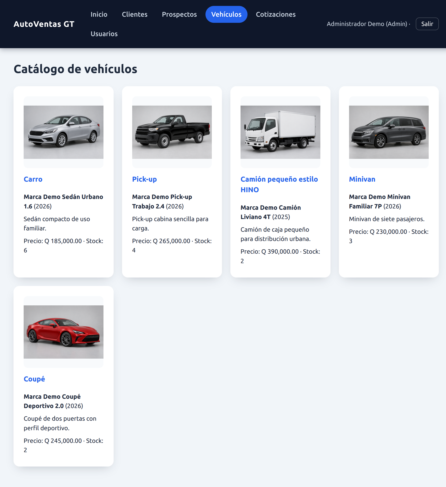
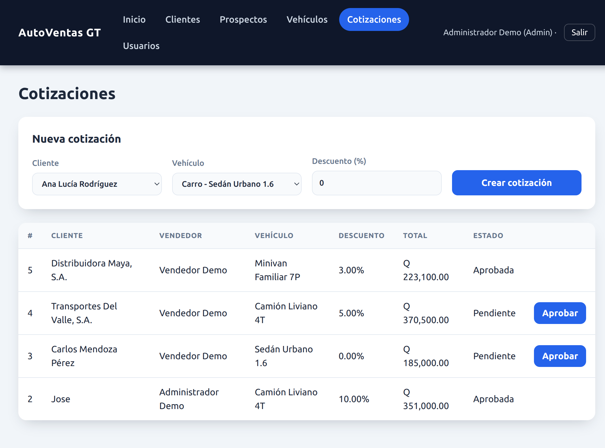
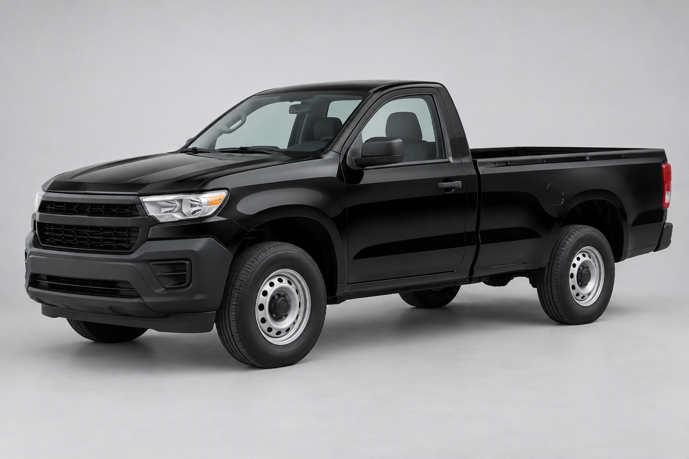
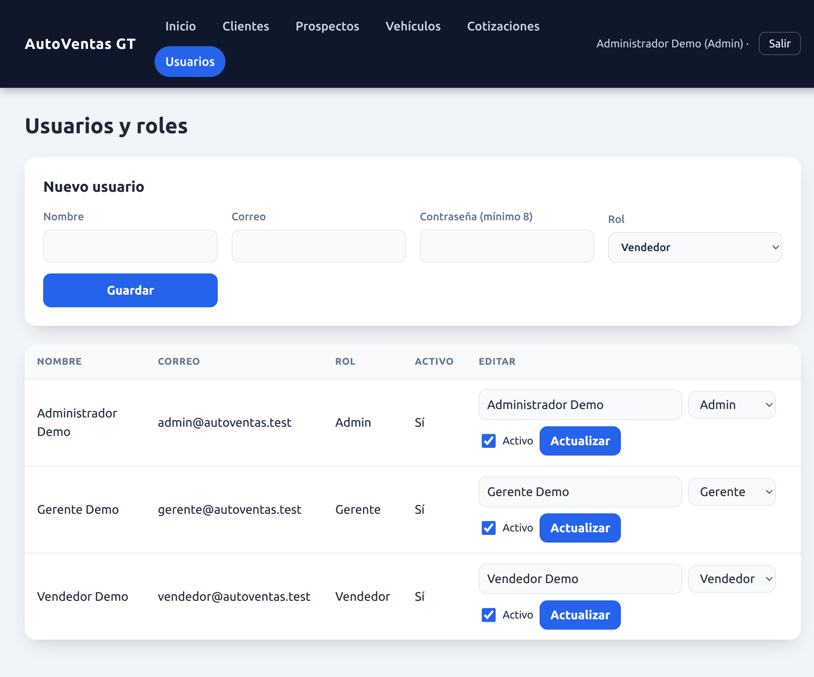

# Presentación: Segunda entrega (Puntos 9 al 15)

Desarrollo de un CRM para AutoVentas GT, S. A.

---

## Slide 1: Portada

**Universidad Da Vinci de Guatemala**
Facultad de Ingeniería, Industria y Tecnología
Ingeniería de Software II

**CRM AutoVentas GT, S. A.**
Segunda entrega: Puntos 9 al 15

Docente: Ing. Raúl Hernández Reyna

Integrantes:
- Antony David Sequen Monroy (202300922)
- Pedro Andrés Pereda Arriola (202404706)
- José Armando Orantes Bolaños (202407391)

---

## Slide 2: Agenda

1. Problema y alcance
2. Gestión de riesgos
3. Triple restricción y gestión de cambios
4. Uso de IA y registro de prompts
5. Arquitectura y seguridad
6. Demostración del MVP
7. Calidad, pruebas y lecciones aprendidas

---

## Slide 3: Problema de AutoVentas GT

- Clientes e inventario en hojas de cálculo y documentos separados.
- Pérdida de oportunidades y datos duplicados.
- Sin seguimiento desde el prospecto hasta la venta.

**Solución:** un CRM con clientes, prospectos, catálogo de vehículos, cotizaciones, usuarios y reportes.

---

## Slide 4: Gestión de riesgos

| Riesgo | Criticidad | Mitigación |
|--------|:----------:|------------|
| R-10: código generado por IA con errores | 9 | Revisión humana y verificación en ejecución |
| R-05: disponibilidad irregular del equipo | 6 | Asignación por integrante y reuniones semanales |
| R-09: cambios de alcance | 6 | Proceso formal de cambios |
| R-12: envío de datos sensibles a la IA | 6 | Solo datos ficticios |

- R-10 se materializó: un error de sintaxis en prospectos impidió cargar la página.

---

## Slide 5: Triple restricción y gestión de cambios

- **Alcance:** 15 HU, 61 SP. MVP con 9 HU Must.
- **Tiempo:** 16 semanas, 8 sprints de 2 semanas.
- **Costo:** 384 HH, con 38 HH de contingencia.

**Proceso de cambios:** solicitud, evaluación, aprobación, implementación y cierre.

**Cambios aprobados en la segunda entrega:**
- Eliminar solo para Admin, con confirmación.
- Bootstrap 5 y modales modernos.
- CRUD completo en todos los módulos.
- Sesión que vence tras 5 minutos de inactividad.
- Respuestas HTTP estándar.
- Imagen de fondo para el login.

---

## Slide 6: Uso de la IA y registro de prompts

- La IA generó código, vistas, documentación e imágenes.
- Cada respuesta se verificó ejecutándola.
- Errores detectados y corregidos quedaron en el registro de prompts.

**Ejemplo real:** un cambio en las vistas introdujo un error de sintaxis. Se corrigió y el caso quedó documentado.

**Límite:** la IA puede proponer rutas o comandos que no existen. El equipo los comprueba en su equipo.

---

## Slide 7: Arquitectura

- **Frontend:** PHP con Bootstrap 5 local. Estilos en `css/` y scripts en `js/`.
- **Backend:** Node.js con Express. Capas de rutas, controladores, servicios y repositorios.
- **Base de datos:** MariaDB.
- **Comunicación:** API REST en JSON.

El frontend no consulta la base de datos. Todo acceso pasa por la API.

---

## Slide 8: Seguridad

- Contraseñas con **bcrypt** (12 rondas).
- **CORS** restringido por variable de entorno.
- Roles con `authenticate` y `authorize`.
- **Sesión** que vence tras 5 minutos de inactividad.
- Respuestas de error estándar (400 a 503) sin detalles internos.
- Control de acceso: eliminar y editar solo para Admin.
- Módulo de usuarios solo para Admin: la pestaña se oculta y la URL directa no da acceso a otros roles.

---

## Slide 9: Demostración: inicio de sesión

*Login con imagen de predio de vehículos. Demo con Admin, Gerente y Vendedor.*

---

## Slide 10: Demostración: dashboard

*Indicadores generales y accesos a los módulos.*

---

## Slide 11: Demostración: clientes y prospectos

*Alta, edición y eliminación (solo Admin) con confirmación.*

---

## Slide 12: Demostración: catálogo y cotizaciones

*Botón Eliminar a la izquierda de Aprobar. Aprobación de descuentos por gerente.*

---

## Slide 13: Catálogo de vehículos

| Imagen | Tipo |
|--------|------|
|  | Carro |
|  | Pickup |
|  | Camión |
|  | Minivan |
|  | Coupé |

*Imágenes ilustrativas generadas con IA.*

---

## Slide 14: Demostración: usuarios y roles

*Módulo solo para Admin: alta, edición, desactivación y eliminación. Un Gerente o Vendedor que escriba la URL `?page=usuarios` no accede a él.*

---

## Slide 15: Calidad y pruebas

- Pruebas funcionales de la API con cURL. Todas aprobadas.
- Restricción por rol verificada con respuesta 403.
- Prueba de interfaz: alta, consulta y eliminación de un cliente de prueba.
- Pendiente: pruebas automatizadas, prueba de vencimiento de sesión y análisis estático.

---

## Slide 16: Lecciones aprendidas

**Qué funcionó:** capas separadas, pruebas directas de la API y configuración por variables de entorno.

**Qué no funcionó:** errores de sintaxis de la IA y documentación desfasada con el código.

**Próximos pasos:** pruebas automatizadas, análisis estático y entrega final.

---

## Slide 17: Cierre

Gracias.

Preguntas y comentarios.
